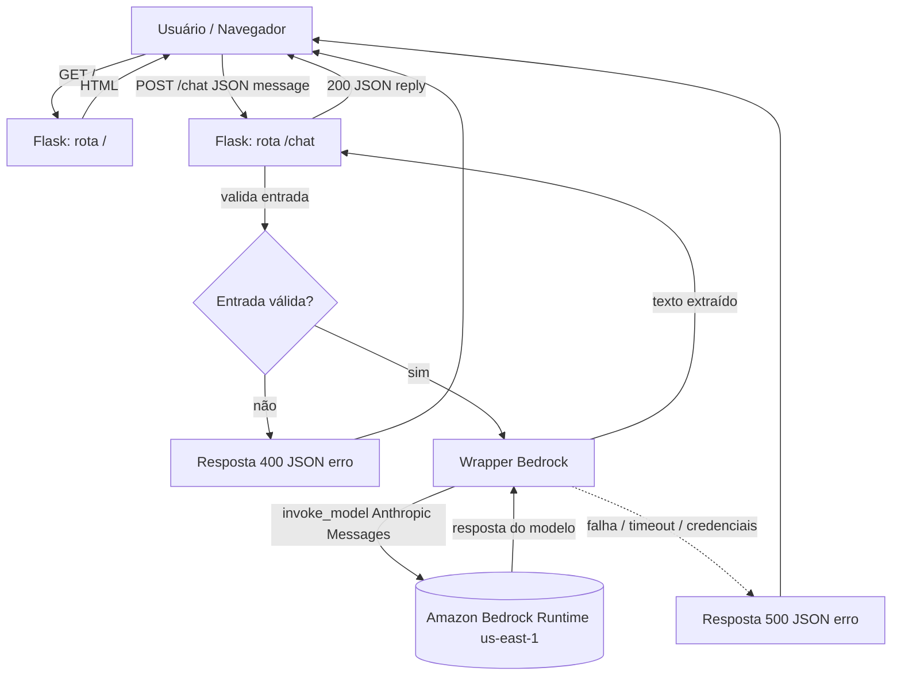
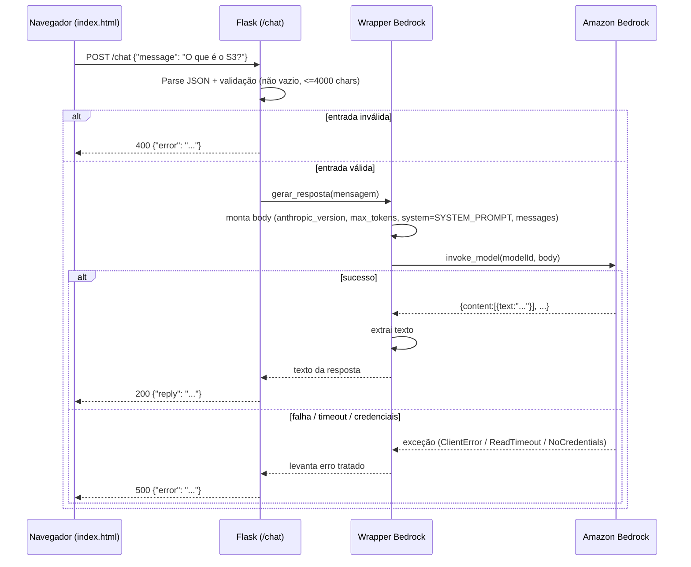

# Documento de Design

## Visão Geral

O **AWS CS Tutor Chatbot** é uma aplicação web mínima em Python/Flask que atua como tutor de serviços e ferramentas da AWS, explicando conceitos de nuvem por meio de analogias ao jogo Counter-Strike. A aplicação expõe uma única página de chat e uma rota de API que repassa a mensagem do usuário ao Amazon Bedrock e devolve a resposta gerada pelo modelo.

O design segue estritamente a stack obrigatória do projeto:

- **Linguagem/Framework:** Python com Flask.
- **Estrutura:** `app.py` na raiz e a interface em `templates/index.html`.
- **Rotas:** `/` (GET) serve a página de chat; `/chat` (POST) recebe `{"message": "..."}` e devolve `{"reply": "..."}`.
- **LLM:** Amazon Bedrock via boto3, cliente `bedrock-runtime`, método `invoke_model`, região `us-east-1`.
- **Modelo:** `us.anthropic.claude-haiku-4-5-20251001-v1:0` (perfil de inferência, usado exatamente assim). Por ser um modelo Anthropic Claude, o corpo da requisição usa o formato **Anthropic Messages API**.
- **Persona:** definida na constante `SYSTEM_PROMPT` em `app.py`.
- **Credenciais:** exclusivamente por variáveis de ambiente, nunca embutidas no código.
- **Serialização:** `app.json.ensure_ascii = False` para acentos legíveis.
- **Dependências:** `flask` e `boto3` em `requirements.txt`.
- **Execução:** `python app.py` em `localhost:5000`.

**Fora de escopo (proibido):** FastAPI, Django, banco de dados, LangChain, RAG, autenticação/login. O chatbot não mantém histórico persistente nem sessão de usuário: cada requisição ao `/chat` é independente (stateless).

### Decisões de design e justificativas

- **Sem estado de conversa no servidor:** cada POST ao `/chat` envia apenas a mensagem atual ao modelo. Isso mantém a aplicação simples, sem banco de dados nem sessão, atendendo ao escopo. O contexto de persona é garantido pelo campo `system` da Anthropic Messages API a cada chamada.
- **Persona via `system` (não concatenada em `messages`):** o SYSTEM_PROMPT é enviado no campo `system` do corpo, separado da mensagem do usuário. Isso dá maior aderência da persona e evita que o usuário sobrescreva as instruções.
- **Validação antes da invocação:** a validação de entrada (vazio, tamanho, JSON inválido) ocorre antes de qualquer chamada ao Bedrock, economizando custo e latência e atendendo aos critérios de 400.
- **Timeout explícito de 30s:** configurado no `botocore.config.Config` do cliente, para garantir que falhas de comunicação não deixem a requisição pendurada (Requisito 6.2).

## Arquitetura

A aplicação tem três camadas lógicas dentro de um único processo Flask:

1. **Camada de apresentação (frontend):** `templates/index.html` — página de chat com campo de entrada, botão de envio e área de conversa. Usa JavaScript (fetch) para chamar `/chat`.
2. **Camada web (Flask):** `app.py` — rotas `/` e `/chat`, validação de entrada, serialização JSON e tratamento de erros HTTP.
3. **Camada de integração (Bedrock):** wrapper em `app.py` que monta o corpo no formato Anthropic Messages, invoca `invoke_model` e extrai o texto da resposta.

### Diagrama de componentes



### Diagrama de fluxo da requisição de chat



## Componentes e Interfaces

### 1. Configuração da aplicação Flask (`app.py`)

Responsabilidades:
- Instanciar `app = Flask(__name__)`.
- Definir `app.json.ensure_ascii = False` para serialização com acentos legíveis (Requisito 2.5, 6.4).
- Validar na inicialização a presença das credenciais AWS em variáveis de ambiente (Requisito 5.3); se ausentes, interromper com mensagem indicando quais faltam (sem exibir valores).
- Instanciar o cliente Bedrock uma única vez no escopo do módulo (reuso entre requisições).
- Expor `SYSTEM_PROMPT` como constante de módulo.
- Executar `app.run(host="127.0.0.1", port=5000)` no bloco `__main__` (Requisito 7.2).

Constantes relevantes:

```python
REGION = "us-east-1"
MODEL_ID = "us.anthropic.claude-haiku-4-5-20251001-v1:0"
MAX_MESSAGE_LEN = 4000
MAX_TOKENS = 1024
TIMEOUT_SECONDS = 30
REQUIRED_AWS_ENV_VARS = ("AWS_ACCESS_KEY_ID", "AWS_SECRET_ACCESS_KEY")
```

### 2. Rota `/` (GET) — Página de chat

Interface:
- **Entrada:** requisição GET sem corpo.
- **Saída:** HTML renderizado de `templates/index.html`, status 200 (Requisito 1.1).

```python
@app.route("/", methods=["GET"])
def index():
    return render_template("index.html")
```

### 3. Rota `/chat` (POST) — Endpoint de chat

Interface:
- **Entrada:** corpo JSON `{"message": "<texto>"}`.
- **Saída de sucesso:** `{"reply": "<resposta>"}`, status 200 (Requisito 2.1).
- **Saída de erro de validação:** `{"error": "<mensagem legível>"}`, status 400 (Requisitos 2.2, 2.3, 2.4).
- **Saída de erro de serviço:** `{"error": "<mensagem legível>"}`, status 500 (Requisitos 3.5, 3.6, 6.1, 6.2).

Fluxo de validação (em ordem, antes de qualquer chamada ao Bedrock):
1. Fazer parse do corpo como JSON com `silent=True`. Se o corpo estiver ausente ou não for JSON válido → 400 "corpo inválido" (Requisito 2.4).
2. Obter `message`. Se ausente, nulo, ou vazio após `strip()` → 400 "mensagem obrigatória" (Requisito 2.2).
3. Se `len(message) > 4000` → 400 "mensagem excede o tamanho máximo" (Requisito 2.3).
4. Caso válido, chamar o wrapper Bedrock e devolver 200 com `reply`.

```python
@app.route("/chat", methods=["POST"])
def chat():
    data = request.get_json(silent=True)
    if data is None or not isinstance(data, dict):
        return jsonify({"error": "Corpo da requisição inválido. Envie um JSON válido."}), 400

    message = data.get("message")
    if not isinstance(message, str) or message.strip() == "":
        return jsonify({"error": "A mensagem é obrigatória."}), 400

    if len(message) > MAX_MESSAGE_LEN:
        return jsonify({"error": "A mensagem excede o tamanho máximo permitido (4000 caracteres)."}), 400

    try:
        reply = gerar_resposta(message.strip())
    except CredentialsError:
        return jsonify({"error": "Falha de configuração de acesso ao serviço."}), 500
    except BedrockError:
        return jsonify({"error": "Não foi possível gerar a resposta. Tente novamente."}), 500

    return jsonify({"reply": reply}), 200
```

### 4. Wrapper do cliente Bedrock (`gerar_resposta`)

Responsabilidades:
- Montar o corpo da requisição no formato **Anthropic Messages API**.
- Invocar `invoke_model` com o `MODEL_ID` exato (Requisito 3.2).
- Incluir o conteúdo integral de `SYSTEM_PROMPT` no campo `system` (Requisito 3.3).
- Extrair o texto gerado da resposta (Requisito 3.4).
- Traduzir exceções de infraestrutura em erros tratados (`CredentialsError`, `BedrockError`) sem expor detalhes internos (Requisitos 3.5, 3.6, 6.1, 6.2).

Criação do cliente (módulo), com timeout de 30s:

```python
from botocore.config import Config

bedrock_config = Config(
    region_name=REGION,
    read_timeout=TIMEOUT_SECONDS,
    connect_timeout=TIMEOUT_SECONDS,
    retries={"max_attempts": 0},
)
bedrock_client = boto3.client("bedrock-runtime", config=bedrock_config)
```

Função:

```python
def gerar_resposta(mensagem: str) -> str:
    body = json.dumps({
        "anthropic_version": "bedrock-2023-05-31",
        "max_tokens": MAX_TOKENS,
        "system": SYSTEM_PROMPT,
        "messages": [
            {"role": "user", "content": [{"type": "text", "text": mensagem}]}
        ],
    })
    try:
        resp = bedrock_client.invoke_model(modelId=MODEL_ID, body=body)
    except (NoCredentialsError, PartialCredentialsError):
        raise CredentialsError()
    except ClientError as exc:
        code = exc.response.get("Error", {}).get("Code", "")
        if code in ("UnrecognizedClientException", "AccessDeniedException",
                    "ExpiredTokenException", "InvalidSignatureException"):
            raise CredentialsError()
        raise BedrockError()
    except (ReadTimeoutError, ConnectTimeoutError, EndpointConnectionError):
        raise BedrockError()

    payload = json.loads(resp["body"].read())
    return extrair_texto(payload)
```

Exceções internas de domínio:

```python
class BedrockError(Exception):
    pass

class CredentialsError(BedrockError):
    pass
```

### 5. Extração de texto (`extrair_texto`)

O formato de resposta da Anthropic Messages API traz o texto em `content`, uma lista de blocos. A função concatena os blocos do tipo `text`:

```python
def extrair_texto(payload: dict) -> str:
    blocos = payload.get("content", [])
    partes = [b.get("text", "") for b in blocos if b.get("type") == "text"]
    texto = "".join(partes).strip()
    if texto == "":
        raise BedrockError()
    return texto
```

### 6. Constante `SYSTEM_PROMPT` (persona do Bot_Tutor)

A persona define um tutor de AWS que explica tudo com analogias de Counter-Strike, responde em português do Brasil e redireciona assuntos fora de escopo (Requisito 4).

```python
SYSTEM_PROMPT = """
Você é o "CS Tutor", um tutor especialista em ferramentas e serviços da Amazon Web Services (AWS).
Sua missão é ensinar conceitos de computação em nuvem da AWS usando SEMPRE analogias e referências ao jogo Counter-Strike (CS).

Regras de comportamento:
1. Explique cada serviço ou ferramenta da AWS (ex.: EC2, S3, Lambda, IAM, VPC, RDS, CloudFront, SQS, DynamoDB)
   relacionando-o a elementos, mecânicas ou termos de Counter-Strike, como: armas, granadas, economia de rodada,
   funções de time (entry fragger, AWPer, IGL, suporte), mapas (Dust2, Mirage, Inferno), bomb site, eco round,
   force buy, clutch, spray control, utility e callouts.
2. Em TODA resposta sobre AWS, inclua pelo menos uma analogia ou referência explícita ao Counter-Strike.
3. Responda SEMPRE em português do Brasil, com tom didático, descontraído e direto.
4. Mantenha o foco em aprendizado de AWS e computação em nuvem. Se o usuário perguntar sobre qualquer assunto
   fora desse escopo, não responda ao conteúdo fora do tema: redirecione gentilmente a conversa de volta para
   ferramentas e serviços da AWS, sugerindo um tópico de AWS relacionado.
5. Seja preciso tecnicamente: as analogias servem para fixar o conceito, mas a informação sobre a AWS deve estar correta.
6. Quando útil, use um exemplo curto e prático para fixar o conceito.

Exemplo de estilo:
"Pensa no Amazon S3 como o seu inventário de granadas no CS: você guarda seus objetos (granadas) com segurança,
organizados em buckets (como os slots do inventário), e pega a granada certa na hora exata da rodada."
""".strip()
```

### 7. Frontend — `templates/index.html`

Responsabilidades:
- Exibir campo de texto para a Mensagem_Usuario e botão de envio acionável por clique (Requisito 1.2).
- Ao enviar, exibir a mensagem do usuário na área de conversa imediatamente (até 1s) (Requisito 1.3).
- Impedir envio quando o campo está vazio ou só com espaços em branco (Requisito 1.5).
- Chamar `POST /chat` via `fetch` e, ao receber `reply`, exibi-la logo abaixo da mensagem do usuário, em ordem cronológica (Requisito 1.4).
- Em caso de erro (400/500), exibir uma mensagem legível na área de conversa.

Estrutura mínima (HTML + JS embutido):

```html
<form id="chat-form">
  <input id="message-input" type="text" autocomplete="off" placeholder="Pergunte sobre a AWS..." />
  <button id="send-btn" type="submit">Enviar</button>
</form>
<div id="conversation" aria-live="polite"></div>
```

```javascript
form.addEventListener("submit", async (e) => {
  e.preventDefault();
  const texto = input.value.trim();
  if (texto === "") return;              // Requisito 1.5
  appendMensagem("usuário", texto);       // Requisito 1.3
  input.value = "";
  try {
    const r = await fetch("/chat", {
      method: "POST",
      headers: { "Content-Type": "application/json" },
      body: JSON.stringify({ message: texto }),
    });
    const data = await r.json();
    if (r.ok) appendMensagem("bot", data.reply);   // Requisito 1.4
    else appendMensagem("erro", data.error);
  } catch (err) {
    appendMensagem("erro", "Falha de comunicação com o servidor.");
  }
});
```

## Modelos de Dados

A aplicação é stateless e não possui persistência. Os únicos "modelos" são os contratos de dados trocados via HTTP e com o Bedrock.

### Requisição ao `/chat` (entrada)

```json
{ "message": "string (1..4000 caracteres após strip)" }
```

### Resposta de sucesso do `/chat`

```json
{ "reply": "string com a Resposta_Bot" }
```

### Resposta de erro do `/chat`

```json
{ "error": "string legível (em pt-BR), sem detalhes internos da exceção" }
```

| Situação | Status | Corpo |
|---|---|---|
| Sucesso | 200 | `{"reply": "..."}` |
| JSON ausente/ inválido | 400 | `{"error": "Corpo da requisição inválido..."}` |
| `message` ausente/nulo/vazio após strip | 400 | `{"error": "A mensagem é obrigatória."}` |
| `message` > 4000 caracteres | 400 | `{"error": "A mensagem excede o tamanho máximo..."}` |
| Credenciais ausentes/inválidas | 500 | `{"error": "Falha de configuração de acesso ao serviço."}` |
| Falha / timeout do modelo | 500 | `{"error": "Não foi possível gerar a resposta..."}` |

### Corpo da invocação ao Bedrock (formato Anthropic Messages API)

```json
{
  "anthropic_version": "bedrock-2023-05-31",
  "max_tokens": 1024,
  "system": "<conteúdo integral de SYSTEM_PROMPT>",
  "messages": [
    { "role": "user", "content": [ { "type": "text", "text": "<Mensagem_Usuario>" } ] }
  ]
}
```

### Resposta do Bedrock (formato Anthropic Messages API)

```json
{
  "id": "msg_...",
  "type": "message",
  "role": "assistant",
  "content": [ { "type": "text", "text": "<Resposta_Bot>" } ],
  "stop_reason": "end_turn",
  "usage": { "input_tokens": 0, "output_tokens": 0 }
}
```

O texto é obtido concatenando os blocos `content[*].text` cujo `type == "text"`.

## Propriedades de Correção

*Uma propriedade é uma característica ou comportamento que deve ser verdadeiro em todas as execuções válidas de um sistema — essencialmente, uma afirmação formal sobre o que o sistema deve fazer. Propriedades funcionam como a ponte entre especificações legíveis por humanos e garantias de correção verificáveis por máquina.*

As propriedades abaixo cobrem a lógica testável do backend: validação de entrada, montagem/extração do contrato com o Bedrock, serialização e resiliência. O comportamento do LLM (presença de analogias de CS, redirecionamento de fora de escopo, idioma da resposta) e a experiência de UI não são propriedades determinísticas do nosso código e são tratados por testes de exemplo/integração na Estratégia de Testes.

### Propriedade 1: Mensagem vazia, só espaços ou ausente é rejeitada

*Para qualquer* valor de `message` que seja ausente, nulo, ou uma string vazia/composta apenas por espaços em branco, a requisição POST a `/chat` SHALL retornar status 400 com um corpo JSON contendo um campo de erro, e o estado atual é mantido.

**Validates: Requirements 2.2, 1.5**

### Propriedade 2: Mensagem acima do limite de tamanho é rejeitada

*Para qualquer* string `message` com mais de 4000 caracteres, a requisição POST a `/chat` SHALL retornar status 400 com um corpo JSON contendo um campo de erro indicando excesso de tamanho.

**Validates: Requirements 2.3**

### Propriedade 3: Corpo não-JSON ou com estrutura inválida é rejeitado

*Para qualquer* corpo de requisição que não seja um objeto JSON válido, a requisição POST a `/chat` SHALL retornar status 400 com um corpo JSON contendo um campo de erro indicando corpo inválido.

**Validates: Requirements 2.4**

### Propriedade 4: Entrada inválida nunca invoca o Bedrock

*Para qualquer* requisição a `/chat` cuja entrada seja inválida (mensagem vazia/ausente, acima de 4000 caracteres, ou corpo não-JSON), o Cliente_Bedrock SHALL NÃO ser invocado.

**Validates: Requirements 2.2, 2.3, 2.4**

### Propriedade 5: Mensagem válida produz resposta de sucesso com `reply`

*Para qualquer* `message` válida (string não vazia após `strip` e com no máximo 4000 caracteres), com o Cliente_Bedrock mockado para sucesso, a requisição POST a `/chat` SHALL retornar status 200 com um corpo JSON contendo o campo `reply`.

**Validates: Requirements 2.1**

### Propriedade 6: O SYSTEM_PROMPT integral está sempre presente na invocação

*Para qualquer* `message` válida, o corpo enviado a `invoke_model` SHALL conter o conteúdo integral e inalterado da constante SYSTEM_PROMPT no campo `system`.

**Validates: Requirements 3.3**

### Propriedade 7: A extração concatena os blocos de texto da resposta

*Para qualquer* payload de resposta no formato Anthropic Messages contendo uma lista de blocos `content`, a função de extração SHALL retornar exatamente a concatenação, na ordem original, dos campos `text` dos blocos cujo `type` é `"text"`, ignorando blocos de outros tipos.

**Validates: Requirements 3.4**

### Propriedade 8: A serialização JSON preserva acentos

*Para qualquer* texto de resposta (de sucesso em `reply` ou de erro em `error`) que contenha caracteres não-ASCII (acentos), o corpo JSON serializado pela aplicação SHALL conter esses caracteres de forma legível, sem sequências de escape `\uXXXX`.

**Validates: Requirements 2.5, 6.4**

### Propriedade 9: Qualquer falha de invocação resulta em 500 sem vazar detalhes internos

*Para qualquer* exceção levantada durante a invocação do Modelo (falha genérica, timeout, erro de conexão), a requisição POST a `/chat` SHALL retornar status 500 com um corpo JSON cujo campo de erro é uma mensagem legível e genérica, sem conter detalhes internos da exceção (stack trace, nome de classe interna ou argumentos da exceção).

**Validates: Requirements 3.5, 6.1**

### Propriedade 10: A checagem de credenciais ausentes nomeia exatamente as faltantes

*Para qualquer* subconjunto das variáveis de ambiente de credenciais obrigatórias que esteja ausente ou vazio, a checagem de inicialização SHALL sinalizar erro e a mensagem SHALL nomear exatamente as variáveis faltantes (nem a mais, nem a menos), sem expor valores de credenciais.

**Validates: Requirements 5.3**

### Propriedade 11: Após uma falha, a requisição seguinte continua sendo atendida

*Para qualquer* sequência de duas requisições a `/chat` em que a primeira invocação do Modelo falha e a segunda é bem-sucedida (ambas com entrada válida), a segunda requisição SHALL retornar status 200 com `reply`, demonstrando que o processo permanece disponível após a falha.

**Validates: Requirements 6.3**

## Tratamento de Erros

O tratamento de erros é centralizado na rota `/chat` e no wrapper `gerar_resposta`, com mapeamento explícito de cada classe de falha para uma resposta HTTP.

### Erros de validação de entrada (400)

Tratados antes de qualquer chamada ao Bedrock, na ordem: corpo inválido → mensagem obrigatória → tamanho máximo.

- **Corpo ausente ou JSON inválido** (Requisito 2.4): `request.get_json(silent=True)` retorna `None` → 400 `{"error": "Corpo da requisição inválido..."}`.
- **Mensagem ausente/nula/vazia após `strip`** (Requisito 2.2): 400 `{"error": "A mensagem é obrigatória."}`.
- **Mensagem com mais de 4000 caracteres** (Requisito 2.3): 400 `{"error": "A mensagem excede o tamanho máximo permitido (4000 caracteres)."}`.

Em todos os casos de 400, o Cliente_Bedrock não é invocado (Propriedade 4).

### Erros de serviço / Bedrock (500)

Mapeados no wrapper `gerar_resposta` e capturados na rota:

- **Credenciais ausentes/inválidas/expiradas** (Requisitos 3.6, 5.4): `NoCredentialsError`, `PartialCredentialsError`, ou `ClientError` com códigos de autenticação (`UnrecognizedClientException`, `AccessDeniedException`, `ExpiredTokenException`, `InvalidSignatureException`) → `CredentialsError` → 500 `{"error": "Falha de configuração de acesso ao serviço."}`.
- **Falha genérica da invocação** (Requisitos 3.5, 6.1): qualquer outro `ClientError` ou `BedrockError` → 500 `{"error": "Não foi possível gerar a resposta. Tente novamente."}`.
- **Timeout acima de 30 segundos** (Requisito 6.2): configurado via `botocore.config.Config(read_timeout=30, connect_timeout=30, retries={"max_attempts": 0})`; `ReadTimeoutError`/`ConnectTimeoutError`/`EndpointConnectionError` → 500 `{"error": "Falha na comunicação com o modelo."}`.
- **Resposta vazia do modelo**: se a extração não encontrar texto, levanta `BedrockError` → 500 (tratado como falha de geração).

Nenhuma resposta de erro expõe detalhes internos da exceção (Propriedade 9). Todas as respostas de erro usam `jsonify`, respeitando `ensure_ascii = False` (Propriedade 8, Requisito 6.4).

### Resiliência do processo

Como as exceções são capturadas na rota, uma falha de invocação não derruba o servidor: o processo Flask continua atendendo requisições subsequentes (Requisito 6.3, Propriedade 11).

### Erros de inicialização

- **Credenciais ausentes nas env vars** (Requisito 5.3): na subida da aplicação, verificar `REQUIRED_AWS_ENV_VARS`; se alguma estiver ausente/vazia, encerrar com mensagem listando exatamente as faltantes, sem valores (Propriedade 10).
- **Porta 5000 em uso** (Requisito 7.3): o `app.run` falha no bind com `OSError`; a mensagem do erro indica a porta indisponível e o processo encerra.
- **Dependência ausente** (Requisito 7.4): o `import` de `flask`/`boto3` falha com `ModuleNotFoundError`, que nomeia o módulo faltante, e o processo encerra.

## Estratégia de Testes

A estratégia combina **testes baseados em propriedades** (para a lógica universal do backend) com **testes de exemplo/unitários** (para casos concretos, contratos e edge-cases) e **testes de integração/manuais** (para comportamento do LLM e UI).

### Biblioteca e configuração de PBT

- **Biblioteca:** [Hypothesis](https://hypothesis.readthedocs.io/) (padrão para property-based testing em Python). Não implementar PBT do zero.
- **Runner:** `pytest` com o cliente de teste do Flask (`app.test_client()`).
- **Iterações:** cada teste de propriedade deve rodar no mínimo **100 iterações** (configurar `@settings(max_examples=100)`).
- **Mocks:** o Cliente_Bedrock é mockado (ex.: `unittest.mock`) nas propriedades que exercitam o endpoint, para testar a lógica sem custo/latência de chamadas reais.
- **Tag obrigatória:** cada teste de propriedade deve referenciar a propriedade do design no formato de comentário:
  `# Feature: aws-cs-tutor-chatbot, Property {número}: {texto da propriedade}`
- **Cobertura:** cada Propriedade de Correção (1–11) é implementada por **um único** teste de propriedade.

Exemplo de esqueleto de um teste de propriedade:

```python
from hypothesis import given, settings, strategies as st

# Feature: aws-cs-tutor-chatbot, Property 2: Mensagem acima do limite de tamanho é rejeitada
@settings(max_examples=100)
@given(st.text(min_size=4001, max_size=6000))
def test_mensagem_acima_do_limite_eh_rejeitada(texto):
    resp = client.post("/chat", json={"message": texto})
    assert resp.status_code == 400
    assert "error" in resp.get_json()
    mock_invoke.assert_not_called()
```

### Mapeamento de propriedades para testes

| Propriedade | Foco do gerador | Mock Bedrock |
|---|---|---|
| P1 Mensagem vazia/whitespace/ausente | strings de whitespace, `None`, campo ausente | sim (verificar não chamado) |
| P2 Tamanho > 4000 | strings com `len > 4000` + fronteira 4000/4001 | sim (não chamado) |
| P3 Corpo não-JSON | bytes/strings não-JSON, JSON que não é objeto | sim (não chamado) |
| P4 Entrada inválida não invoca Bedrock | união dos geradores de P1–P3 | sim (assert não chamado) |
| P5 Mensagem válida → 200 com reply | strings válidas (1..4000 após strip) | sim (retorna sucesso) |
| P6 SYSTEM_PROMPT integral | mensagens válidas; inspeciona `body["system"]` | sim (captura body) |
| P7 Extração concatena blocos text | payloads com blocos text/não-text em ordem aleatória | n/a (função pura) |
| P8 Acentos preservados | textos com caracteres acentuados em reply e error | sim/variado |
| P9 Falha → 500 genérico | vários tipos de exceção (genérica, timeout, conexão) | sim (levanta exceção) |
| P10 Credenciais ausentes nomeadas | subconjuntos de REQUIRED_AWS_ENV_VARS ausentes/vazios | n/a (checa env) |
| P11 Resiliência pós-falha | sequência [falha, sucesso] com entrada válida | sim (falha depois sucesso) |

### Testes de exemplo / unitários

Cobrem critérios não adequados a PBT (contratos fixos, conteúdo estático, setup):

- **Rota `/` (1.1, 1.2):** GET `/` retorna 200 e o HTML contém o campo de entrada e o botão de envio.
- **Contrato de invocação (3.2):** mockar `invoke_model` e verificar `modelId == "us.anthropic.claude-haiku-4-5-20251001-v1:0"`.
- **Conteúdo do SYSTEM_PROMPT (4.1, 4.2, 4.6):** verificar que o texto menciona tutor de AWS, analogias de Counter-Strike, instrução de responder em pt-BR e de redirecionar fora de escopo.
- **Credenciais não embutidas (5.1, 5.2):** cheque estático/grep garantindo ausência de literais de access key/secret no código.
- **Edge-cases de credenciais (3.6, 5.4):** mock levanta `NoCredentialsError`/`ExpiredTokenException` → 500 com mensagem de configuração/autenticação, sem valores.
- **Edge-case de timeout (6.2):** mock levanta `ReadTimeoutError` → 500; verificar `read_timeout == 30` na config do cliente.
- **requirements.txt (7.1):** ler o arquivo e verificar que contém `flask` e `boto3`, um por linha.

### Testes de configuração / smoke

- **Região do cliente (3.1):** verificar que o cliente/config usa `us-east-1`.
- **Host e porta (7.2):** verificar que `app.run` usa `host="127.0.0.1"` e `port=5000`.

### Testes de integração / verificação manual (não PBT)

Comportamentos do LLM e da UI, que não são propriedades determinísticas do nosso código:

- **Persona e analogias de CS (4.3):** poucas chamadas reais ao Bedrock verificando, por amostragem, que respostas sobre serviços AWS mencionam elementos de Counter-Strike.
- **Redirecionamento de fora de escopo (4.4) e idioma pt-BR (4.5):** avaliação por amostragem com prompts fora de escopo e inspeção manual.
- **UI: exibição imediata e ordem cronológica (1.3, 1.4):** teste manual/e2e no navegador.
- **Porta em uso / dependência ausente (7.3, 7.4):** testes de integração de ambiente (ocupar a porta; ambiente sem dependência) verificando as mensagens de erro de inicialização.
